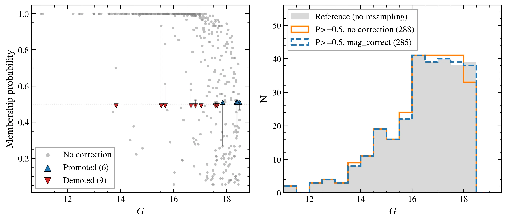

.. _membership_module:

Membership module
#################

The :py:class:`asteca.Membership` class allows estimating the membership probabilities
for all the stars in a given observed field, using the
:py:meth:`asteca.Membership.fastmp` method.

The :py:meth:`fastmp <asteca.Membership.fastmp>` method was described in detail in the
`article <https://academic.oup.com/mnras/article/526/3/4107/7276628>`__
where the `Unified Cluster Catalogue (UCC) <https://ucc.ar/>`__ was introduced. The
method requires proper motions, and parallax data dimensions stored in the
:py:class:`Cluster <asteca.Cluster>` object, along with the center values
``radec_c, pms_c, plx_c`` (see :ref:`structure`). Photometric data is not employed to
estimate the probabilities, but the magnitude can be used to correct them (see
:ref:`mag_correct`).

To use this method we need to estimate the cluster's number of members as described in
the :ref:`nmembers` section, which is done by calling the
:py:meth:`asteca.Cluster.get_nmembers` method.

With the ``N_cluster`` attribute in place in a
:py:class:`Cluster <asteca.Cluster>` object, here called ``my_field``, you can
apply the :py:meth:`fastmp <asteca.Membership.fastmp>` method (part of the
:py:class:`Membership <asteca.Membership>` class) as follows:

.. code-block:: python

    # Run `fastmp` method
    my_field.membership.fastmp()

Here ``my_field.membership`` is a :py:class:`Membership <asteca.Membership>`
object tied to ``my_field``, created along with it, so there is no need to create one.
The call above is equivalent to ``asteca.Membership(my_field).fastmp()``.

The per-star membership probabilities array is stored in the ``probs`` attribute
of the ``my_field`` object.

Following the obtention of the membership probabilities, the next step is to apply a
selection criterion to filter out likely non-members from the dataset. This can be
achieved using the :py:meth:`asteca.Membership.select_members` method, which allows
users to retain only those stars that meet specific membership probability thresholds or
to limit the number of accepted members based on their probabilities.

This operation returns a new :py:class:`Cluster <asteca.Cluster>` object
that contains only the selected stars:

.. code-block:: python

    # Apply membership selection method
    my_cluster = my_field.membership.select_members()

All the per-star arrays of ``my_cluster`` (such as coordinates, magnitudes, and
kinematic data) contain only the accepted subset of most probable members. The
``my_field`` object is not modified, so the selection can be repeated with different
criteria. By default, stars with probabilities equal to or above ``0.5`` are selected.
Use the ``prob_min`` argument to change this threshold, or ``N_prob_max`` to keep
instead the ``N_prob_max`` stars with the largest probabilities (only one of the two
can be given).

A step-by-step example is shown in the :ref:`membership_ntbk` tutorial.

.. _mag_correct:

Magnitude correction
====================

Since the :py:meth:`fastmp <asteca.Membership.fastmp>` method resamples the data using
their uncertainties, it favors stars with small uncertainties (i.e.: brighter stars).
With ``mag_correct=True`` the probabilities are adjusted so that a ``P>=0.5`` selection
follows the magnitude distribution of the members selected with no resampling. This
requires the ``mag`` attribute:

.. code-block:: python

    # Run `fastmp` method with the magnitude correction
    my_field.membership.fastmp(mag_correct=True)

The figure below shows the effect of ``mag_correct=True`` on the Gaia DR3 field
(``G<20``) around `Kronberger 31 <https://ucc.ar/_clusters/kronberger31/>`__, a distant
cluster with not many members in the UCC.
The CMDs show the ``P>=0.5`` members colored by their probabilities
over the field stars (grey), without (left) and with (right) the correction. Without
the correction fewer stars reach ``P>=0.5``, and almost none of them are fainter than
``G=18.5``, where the uncertainties are largest. With the correction more stars
reach ``P>=0.5`` with many faint stars promoted (just above ``P=0.5``) and a few
brighter ones are demoted, recovering the magnitude distribution of the members
selected with no uncertainties resampling.

