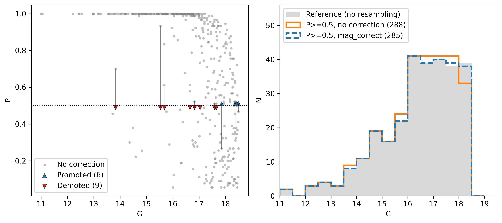

.. _membership_module:

Membership module
#################

The :py:class:`asteca.Membership` class allows estimating the membership probabilities
for all the stars in a given observed field. There are currently two methods included in
this class: :py:meth:`asteca.Membership.bayesian` and
:py:meth:`asteca.Membership.fastmp`.

The :py:meth:`bayesian` method was described in detail in the `article`_ where **ASteCA**
was originally introduced. The method requires ``(ra, dec)``  data and will use any extra
data dimensions stored in the :py:class:`Cluster <asteca.cluster.Cluster>` object, i.e.:
photometry, proper motions, and parallax. At least one extra data dimension beyond
``(ra, dec)`` is required (three dimensions total minimum). This method can produce
membership probabilities on photometric data alone. It also requires the ``(ra, dec)``
center (``radec_c``) and the ``radius`` of the cluster, in degrees, to be stored in the
:py:class:`Cluster <asteca.cluster.Cluster>` object (see :ref:`structure`).

The :py:meth:`fastmp` method was described in detail in the
`article <https://academic.oup.com/mnras/article/526/3/4107/7276628>`__
where the `Unified Cluster Catalogue (UCC) <https://ucc.ar/>`__ was introduced. The
method requires proper motions, and parallax data dimensions stored in the
:py:class:`Cluster <asteca.cluster.Cluster>` object, along with the center values
``radec_c, pms_c, plx_c`` (see :ref:`structure`). Photometric data is not employed to
estimate the probabilities, but the magnitude can be used to correct them: since the
method resamples the data using their uncertainties, it favors stars with small
uncertainties (i.e.: brighter stars). With ``mag_correct=True`` the probabilities are
adjusted so that a ``P>=0.5`` selection follows the magnitude distribution of the
members selected with no resampling. This requires the ``mag`` attribute.

The figure below shows the effect of ``mag_correct=True`` on the field used in the
:ref:`membership_ntbk` tutorial. Left: probabilities with no correction (grey) and the
stars whose probabilities are moved across ``P=0.5`` by the correction (promoted or
demoted). Right: magnitude distribution of the ``P>=0.5`` members with and without the
correction, compared to the members selected with no resampling (reference). Without
the correction, the faintest magnitudes are under-represented in the ``P>=0.5``
selection. The correction changes only a few stars in this example, but it can have
a larger effect in fields with a wider range of uncertainties.

.. important::
    The only advantage of the :py:meth:`bayesian` method over the :py:meth:`fastmp`
    method is that the former works with photometric data. Hence it should only be used
    in cases where only photometric data is available, as :py:meth:`fastmp` is not only
    much faster but also more precise in those cases where proper motions and/or
    parallax data is available.

To use these methods we need to estimate the cluster's number of members as described in
the :ref:`nmembers` section, which is done by calling the
:py:meth:`asteca.Cluster.get_nmembers` method.

With the ``N_cluster`` attribute in place in a
:py:class:`Cluster <asteca.cluster.Cluster>` object, here called ``my_field``, you can
apply either the :py:meth:`bayesian` or the :py:meth:`fastmp` method (both part
of the :py:class:`Membership <asteca.membership.Membership>` class) as follows:

.. code-block:: python

    # Run `fastmp` method
    my_field.membership.fastmp()

    # Run `bayesian` method
    my_field.membership.bayesian()

The per-star membership probabilities arrays are stored in the ``probs`` attribute
of the ``my_field`` object.

Following the obtention of the membership probabilities, the next step is to apply a
selection criterion to filter out likely non-members from the dataset. This can be
achieved using the :py:meth:`asteca.Membership.select_members` method, which allows
users to retain only those stars that meet specific membership probability thresholds or
to limit the number of accepted members based on their probabilities.

This operation returns a new :py:class:`Cluster <asteca.cluster.Cluster>` object
that contains only the selected stars:

.. code-block:: python

    # Apply membership selection method
    my_cluster = my_field.membership.select_members()

All the per-star arrays of ``my_cluster`` (such as coordinates, magnitudes, and
kinematic data) contain only the accepted subset of most probable members. The
``my_field`` object is not modified, so the selection can be repeated with different
criteria. By default, stars with probabilities equal to or above ``0.5`` are selected.
Use the ``prob_min`` argument to change this threshold, or ``N_prob_max`` to keep
instead the ``N_prob_max`` stars with the largest probabilities (only one of the two
can be given).

A step-by-step example is shown in the :ref:`membership_ntbk` tutorial.

.. _article: https://doi.org/10.1051/0004-6361/201424946