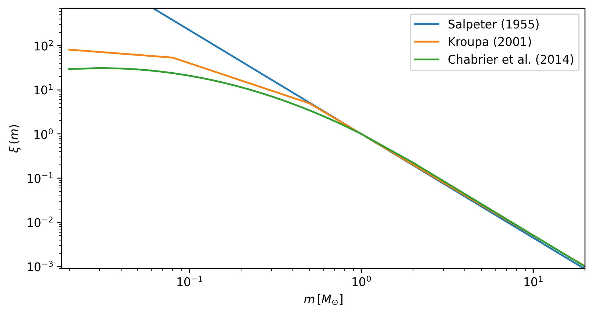
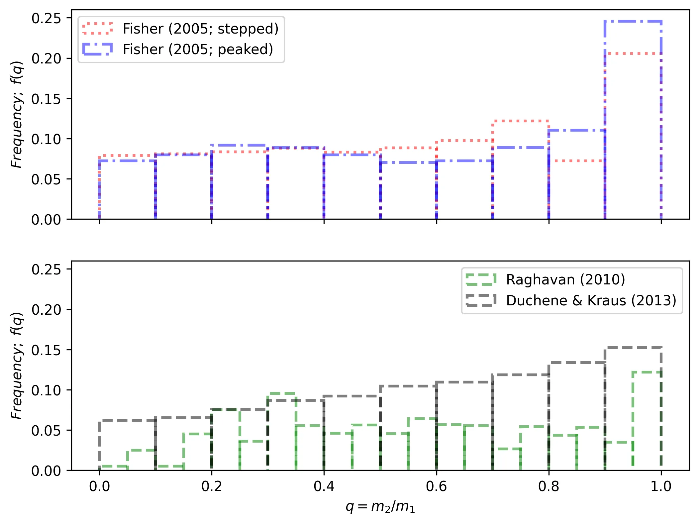
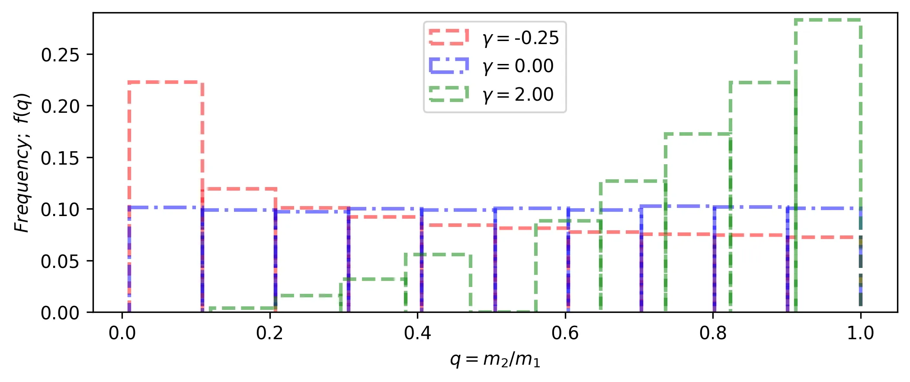
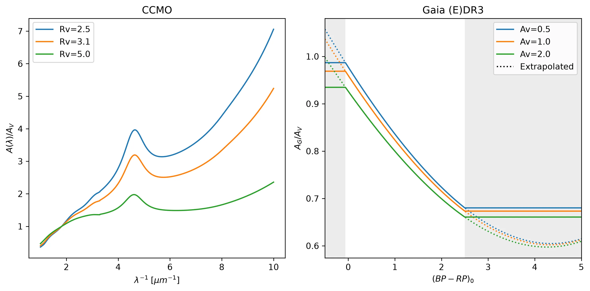
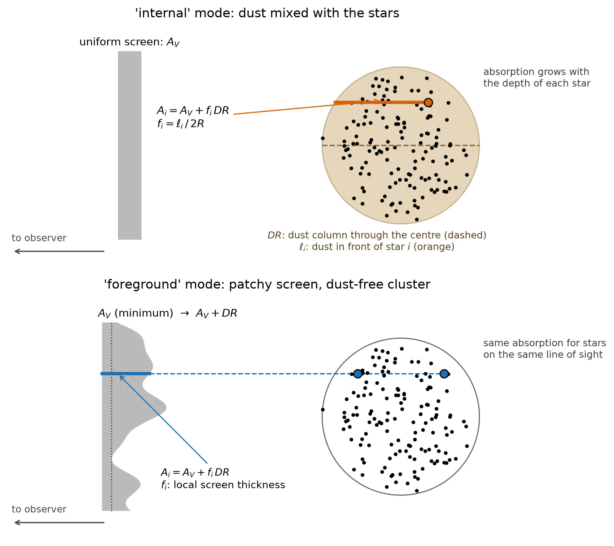
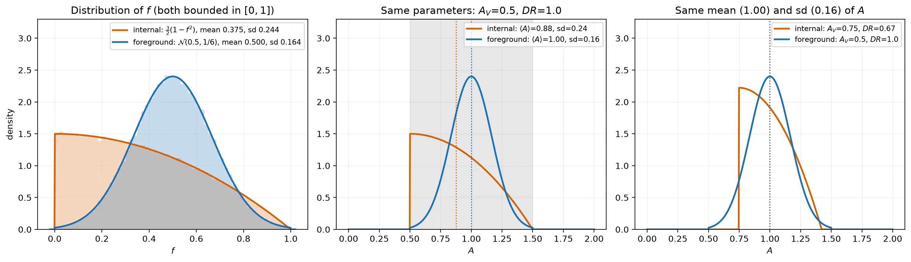
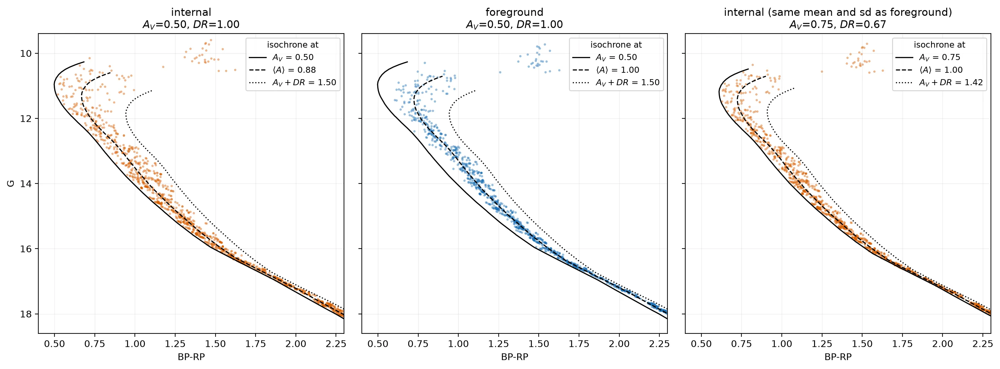
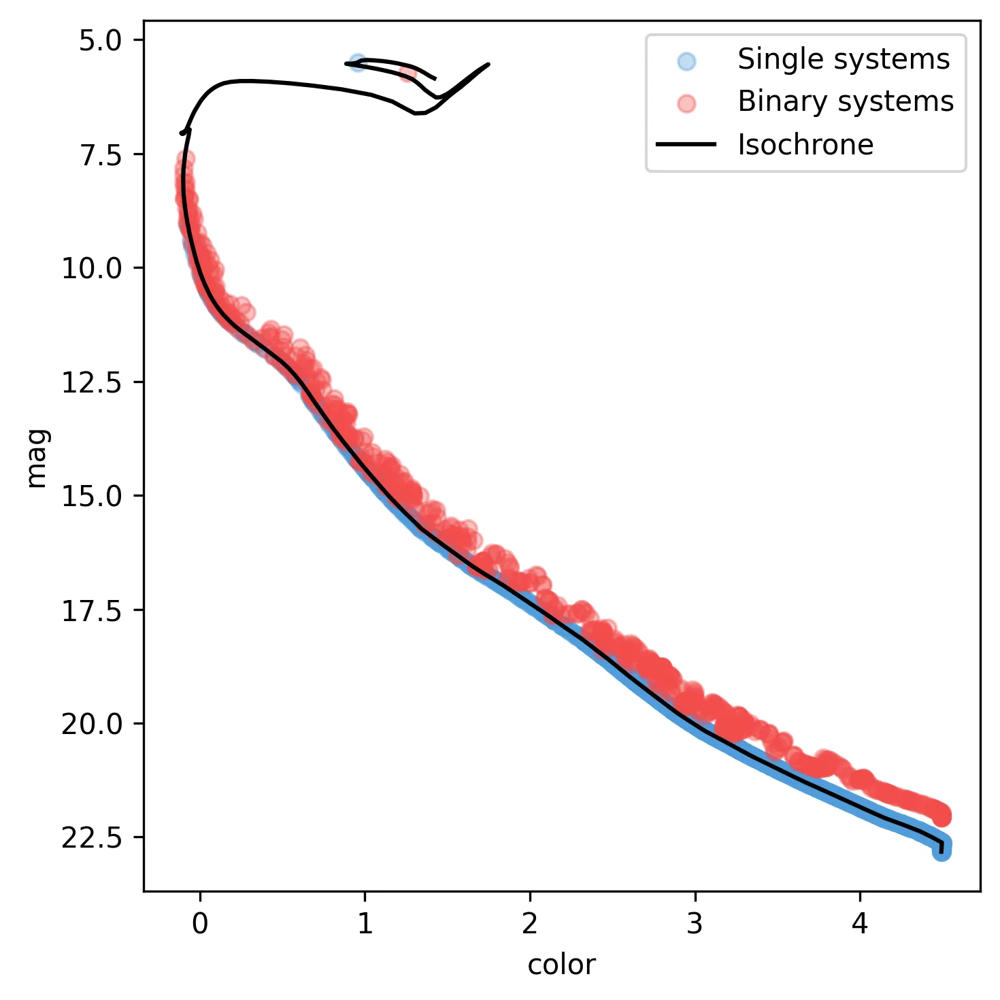
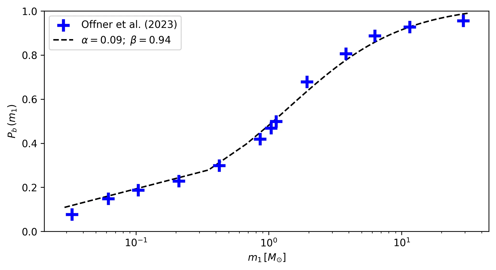
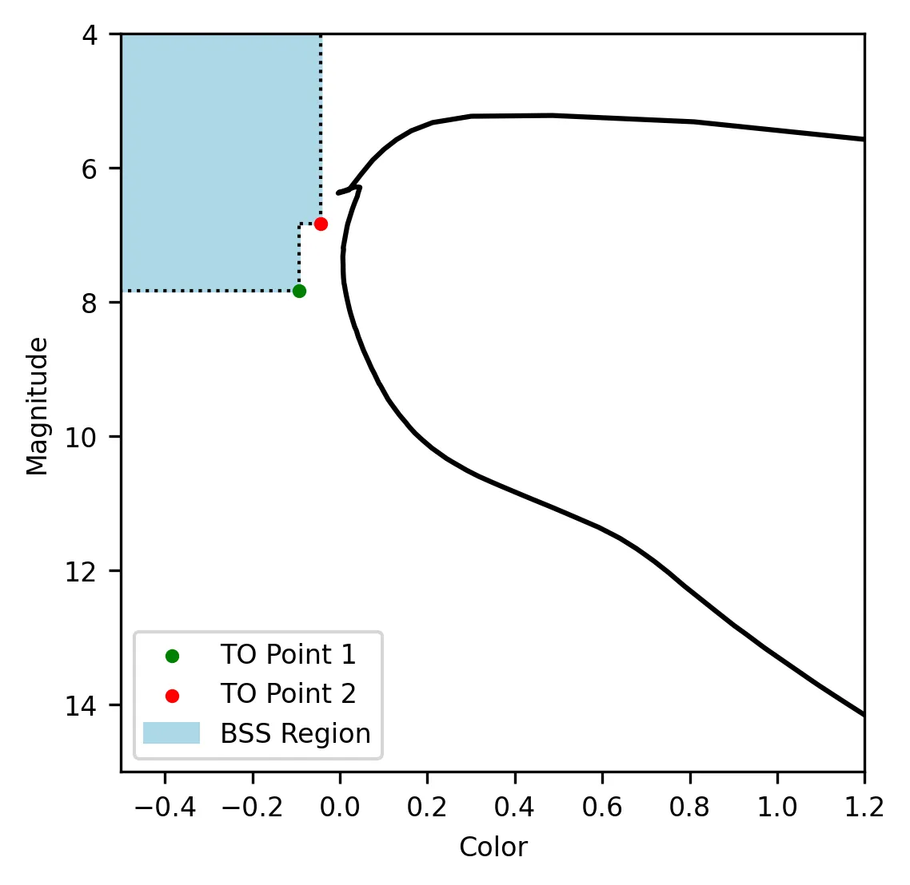

.. _synthetic_module:

Synthetic module
################

The :py:class:`asteca.Synthetic` class allows generating synthetic clusters from:

1. A :py:class:`asteca.Isochrones` object
2. A dictionary of fundamental parameters
3. A :py:class:`asteca.Cluster` object (optional, used for calibration)

The handling of a :py:class:`asteca.Synthetic` object is explained in detail in the sub-sections
that follow.

.. _ref_defining:

Defining the object
*******************

To instantiate a :py:class:`asteca.Synthetic` object you need to pass the
:obj:`isochs` object previously generated, as explained in the
:ref:`isochrones_module` section.

.. code-block:: python

    # Synthetic clusters object
    synthcl = asteca.Synthetic(isochs)

This will load the theoretical isochrones and perform the required initial processing
to define a :obj:`synthcl` object. The processing involves sampling an `initial
mass function`_ (IMF) up to a total maximum mass, setting the distributions for the
binary systems' mass ratio, defining the extinction law, and selecting the differential
reddening model.

The basic example above uses the default values for these processes, but
they can be modified by the user at this stage via their arguments. These arguments
are (also see :py:class:`asteca.Synthetic`):

.. code-block:: console

    def_params       : Default values for the fundamental parameters
    IMF_name         : Initial mass function
    max_mass         : Maximum total initial mass
    gamma            : Distribution for the mass ratio of the binary systems
    ext_law          : Extinction law
    DR_distribution  : Model for the differential reddening
    seed             : Random seed

The ``def_params`` argument is explained in :ref:`ref_generating`. The ``seed``
argument fixes the random values used to generate the synthetic clusters (IMF masses,
binary systems, differential reddening, photometric uncertainties), so that the same
parameters always produce the same synthetic cluster for a given
:py:class:`asteca.Synthetic` object. If it is not given, a random seed is used (shown in
the output when ``verbose>1``). The remaining arguments are explained in more detail in
the following sub-sections.

Initial mass function
=====================

The ``IMF_name`` and ``max_mass`` arguments are used to generate random mass samples from
an IMF. To improve the performance of the code, this step is performed when the
:py:class:`asteca.Synthetic` object is created instead of every time a new synthetic
cluster is generated. The ``IMF_name`` argument must be one of those available in
:py:class:`asteca.Synthetic`, associated to IMFs defined in `Salpeter (1955)`_,
`Kroupa (2001)`_, and `Chabrier et al. (2014)`_ (the default value). These are
shown in the figure below:

The ``max_mass`` argument fixes the total mass value to be sampled from the IMF (hence,
it also controls the total number of synthetic stars). This
value should be large enough to allow generating as many synthetic stars as those
present in the observed cluster. The default value is :math:`10000\;M_{\odot}` which
should be more than enough for the majority of clusters. As a rule of thumb, it should
be at least 7 times the number of observed stars (i.e.: :math:`7\times N` in
:math:`M_{\odot}`); a warning is shown by the :py:meth:`asteca.Synthetic.calibrate`
method if this is not the case.

Binary systems
==============

The ``gamma`` argument (:math:`\gamma`) defines the distribution of the mass ratio for
the binary systems. The mass ratio is the ratio of secondary masses (:math:`m_2`)
to primary masses (:math:`m_1`) in binary systems, written as
:math:`q=m_2/m_1\,(<=1)`. As with the IMF, the :math:`q` distribution is fixed, not
fitted, to improve the performance.

We use ``gamma`` as an argument because the :math:`q` distribution is usually defined
as a power-law, where ``gamma`` or :math:`\gamma` is the exponent or power:

.. math::

    f(q) \approx q^{\gamma(m_1)}

Here, :math:`f(q)` is the distribution of :math:`q` (the mass-ratio) where 
:math:`\gamma(m_1)` means that the value of :math:`\gamma` depends on the primary mass
of the system (this dependence is only true for the `Duchene & Kraus (2013)`_
distribution, see below).

The default selection is ``gamma=D&K``, with ``D&K`` meaning the primary mass-dependent
distribution by `Duchene & Kraus (2013)`_ (see their Table 1 and Figure 3). The user
can also select between the two distributions by `Fisher et al. (2005)`_ (stepped
and peaked, see their Table 3) and `Raghavan et al. (2010)`_ (see their Fig 16,
left). In practice they all look somewhat similar, as shown in the figure below for a
random IMF mass sampling.

The Fisher distributions (top row) favor :math:`q` values closer to unity (i.e.:
secondary masses that are similar to the primary masses), while the Raghavan and
Duchene & Kraus distributions (bottom row) look a bit more uniform.

The user can also select a float value for ``gamma``, which will be used as an
exponent in the power-law function :math:`f(q) \approx q^{\gamma}`. The figure below
shows this distribution for three ``gamma`` (:math:`\gamma`) values, where ``gamma=0``
means a uniform distribution.

Only the Duchene & Kraus distribution is primary-mass dependent. The Fisher and Raghavan
distributions, as well as the distributions set by the user via a float value for
``gamma``, are independent of mass values.

.. _extinction_law:

Extinction law
==============

An extinction law is required to transform the extinction of the photometric system
used for the observed data (the same system used for the isochrones), into the standard
total visual absorption parameter :math:`A_V`. This is defined by the
``ext_law`` argument as one of either ``CCMO`` or ``GAIADR3``.
The first one (``CCMO``) corresponds to the model by
`Cardelli, Clayton & Mathis (1989)`_, with updated coefficients for near-UV from
`O'Donnell (1994)`_. The second one (``GAIADR3``) is `Gaia's (E)DR3`_, color-dependent
law (main sequence), only applicable to Gaia's photometry. If this law is selected,
**ASteCA** assumes that the magnitude and first color used are Gaia's
:math:`G` and :math:`BP-RP` respectively. The coefficients of this law are
polynomials in the intrinsic color, fitted for :math:`-0.06<(BP-RP)_0<2.5`, which
diverge outside of that range. Stars outside of it (e.g.: very red dwarfs) are
assigned the coefficients of the closest valid color.

While the ``CCMO`` law requires defining the effective lambdas for each filter
in the photometric system when defining the :py:class:`asteca.Isochrones` object
(see :ref:`isochrones_module`), the ``GAIADR3`` law does not require this data
as the extinction coefficients are already defined for Gaia's photometry.

.. important::

    While ``CCMO`` allows different ratio of total to selective extinction :math:`R_V`
    values (which means this parameter can even be fitted), the coefficients of
    ``GAIADR3`` were derived from a single extinction curve (:math:`R_V\approx 3.1`).
    Hence the ``Rv`` parameter has **no effect** when this law is used: it should be
    kept fixed, since fitting it would just return its prior. A warning is shown if the
    :py:class:`asteca.Synthetic` object is created with this law and a default
    ``Rv`` value different from ``3.1``. Please read the online documentation and its
    accompanying articles  to learn more about this law's limitations.

The figure below shows a comparison of the extinction laws implemented in **ASteCA**.
Left panel: the ``CCMO`` law showing the normalized extinction curve
:math:`A(\lambda)/A_V` as a function of inverse wavelength for different values of 
:math:`R_V`.
Right panel: ``GAIADR3`` color-dependent extinction law for main-sequence stars,
applicable only to Gaia mission photometry, showing the variation of :math:`A_G/A_V`
with intrinsic :math:`BP-RP` color for different extinction values. The grey regions are
outside the range where the coefficients were fitted: the solid lines show the
(clamped) values used by **ASteCA**, the dotted lines the extrapolated polynomials.

There are dedicated packages like `dustapprox`_, `dust_extinction`_ or `extinction`_
that can handle the extinction coefficients generation. We employ our own
implementation of the ``CCMO`` law adapted from an `IDL Astronomy User's Library`_
script, to increase the performance. If you want to use a different extinction model,
please drop me an `email <mailto:gabrielperren@gmail.com>`_.

To load the :py:class:`asteca.Synthetic` object with the ``GAIADR3`` extinction
law, simply select it when instantiating the object, as follows:

.. code-block:: python

    # Synthetic clusters object
    synthcl = asteca.Synthetic(isochs, ext_law="GAIADR3")

Differential reddening
======================

The ``DR_distribution`` argument selects the model used for the differential
reddening (assuming :math:`DR>0`, see Section :ref:`ref_generating`). It accepts one
of two string values: ``foreground`` (the default) or ``internal``. Both models
assign to each star :math:`i` the absorption

.. math::

   A_i = A_V + f_i\, DR, \qquad 0 \le f_i \le 1

where :math:`A_V` and :math:`DR` are the fitted parameters and :math:`f_i` is a
random fraction. The two models share the following properties:

- :math:`A_V` is the **minimum** absorption in the cluster and :math:`A_V + DR` the
  maximum. Every star has :math:`A_V \le A_i \le A_V + DR`.
- No value is ever negative, so nothing needs to be clipped at zero. There is no
  :math:`DR \le A_V` restriction, and a cluster with :math:`A_V = 0` and
  :math:`DR > 0` is valid.
- :math:`DR = 0` gives every star the same absorption :math:`A_V`.

The models differ only in how :math:`f_i` is distributed. That distribution stands
for a geometry of the dust, which in turn sets what :math:`A_V` and :math:`DR`
mean physically:

- ``internal``: the stars are mixed with dust inside the cluster, behind a uniform
  foreground screen.
- ``foreground``: the cluster is free of dust and is seen through a patchy
  foreground screen.

.. list-table::
   :header-rows: 1
   :widths: 20 40 40

   * -
     - ``internal``
     - ``foreground``
   * - :math:`A_V`
     - Uniform foreground absorption, the same for every member
     - Minimum foreground absorption across the face of the cluster
   * - :math:`DR`
     - Absorption of the dust inside the cluster, through its centre from front to
       back
     - Full range of the foreground variations across the face of the cluster
   * - Absorption of a star depends on
     - Its depth inside the cluster
     - Its position on the sky
   * - Suited to
     - Young clusters that still contain gas and dust
     - Clusters without internal dust, seen through a patchy foreground (e.g.
       through or behind a molecular cloud)

The figure below shows the geometry of the two models. The top panel shows
the ``internal`` model, where the absorption of a star depends on how deep it
sits inside the dusty cluster. The bottom panel shows the ``foreground`` model
where it depends on the screen thickness along the star's line of sight, not on
its depth.

The ``internal`` model
----------------------

This model assumes that

- a uniform foreground screen adds the same absorption :math:`A_V` to every
  member, and
- the cluster is a sphere of radius :math:`R` filled with dust of uniform density,
  with the stars distributed uniformly through it.

:math:`DR` is then the absorption of the internal dust column along the line of
sight through the centre of the cluster, from front to back (a length
:math:`2R`). A star with a path :math:`\ell_i` of dust in front of it, before the
edge of the cluster, has

.. math::

   f_i = \frac{\ell_i}{2R}

Stars on the near side of the cluster have :math:`f_i \approx 0`. Only a star at
the far edge, on the central line of sight, reaches :math:`f_i = 1`.

For stars uniformly distributed in the sphere, the distribution of :math:`f` can
be derived exactly. For a star at projected radius :math:`\rho` the chord through
the cluster has half-length :math:`h=\sqrt{R^2-\rho^2}`, and :math:`f` is uniform
in :math:`[0, h/R]`. Averaging over the distribution of :math:`h` gives

.. math::

   p(f) = \frac{3}{2}\left(1 - f^2\right), \qquad 0 \le f \le 1

This density is largest at :math:`f=0`, where the stars just behind the front
surface of the cluster pile up. It falls to zero at :math:`f=1`. Its mean is
:math:`3/8=0.375`, its standard deviation is :math:`0.244`, and it is skewed
towards high :math:`f` (skewness :math:`0.38`). About 15% of the stars have
:math:`f<0.1`.

Its cumulative distribution :math:`F(f) = (3f - f^3)/2` can be inverted in closed
form, so :math:`f` is sampled from a uniform random number
:math:`u \sim \mathcal{U}(0, 1)` as

.. math::

   f = 2 \sin\!\left(\frac{\arcsin u}{3}\right)

The ``foreground`` model
------------------------

This model assumes that

- the cluster contains no dust, and
- the foreground screen in front of it is patchy, so its absorption varies across
  the face of the cluster.

Each star takes the absorption of the screen along its own line of sight. Stars
that are close together on the sky but at different depths in the cluster get the
same absorption.

The screen's absorption is taken to follow a normal distribution truncated at
:math:`\pm 3\sigma`, with :math:`A_V` at the lower end and :math:`A_V + DR` at the
upper end. Here :math:`A_V` is the **minimum** foreground absorption towards the
cluster and :math:`DR` is the full range of its variation (about :math:`6\sigma`):

.. math::

   f \sim \mathcal{N}\!\left(\tfrac{1}{2},\, \tfrac{1}{6}\right),
   \quad \text{truncated to } [0, 1]

The distribution is symmetric about :math:`f=0.5`, with a standard deviation of
:math:`0.164`. Fewer than 1% of the stars fall in each of the outer tenths
(:math:`f<0.1` or :math:`f>0.9`). It is sampled from a uniform random number
through the inverse cumulative distribution of the normal.

How the two distributions differ
--------------------------------

.. list-table::
   :header-rows: 1
   :widths: 40 30 30

   * -
     - ``internal``
     - ``foreground``
   * - Density of :math:`f`
     - :math:`\frac{3}{2}(1-f^2)`
     - :math:`\mathcal{N}(0.5, 1/6)`, truncated at :math:`\pm 3\sigma`
   * - Mean of :math:`f`
     - 0.375
     - 0.500
   * - Standard deviation of :math:`f`
     - 0.244
     - 0.164
   * - Median / mode of :math:`f`
     - 0.347 / 0
     - 0.5 / 0.5
   * - Skewness
     - 0.38
     - 0
   * - :math:`P(f<0.1)` / :math:`P(f>0.9)`
     - 15% / 1.5%
     - 0.7% / 0.7%
   * - Mean absorption :math:`\langle A\rangle`
     - :math:`A_V + 0.375\,DR`
     - :math:`A_V + 0.5\,DR`
   * - Spread of the absorption
     - :math:`0.244\,DR`
     - :math:`0.164\,DR`

.. note::

   Each synthetic star gets its own value of :math:`f`, drawn independently. The
   absorption is applied after the star's mass is interpolated into the isochrone
   and its binary companion (if any) is added, and the extinction coefficients of
   the ``GAIADR3`` law are evaluated at the intrinsic color of the system. The stars
   of the synthetic cluster thus follow the distributions above exactly, and stars
   of similar masses are reddened independently, as in a real cluster.

   Since a star's absorption is only known after it is generated, the stars that
   end up fainter than the maximum magnitude of the observed cluster are discarded,
   and more stars are generated until the synthetic cluster has as many stars as
   the observed one. With a large :math:`DR` the number of stars required from
   the IMF sample grows accordingly, so a larger ``max_mass`` value may be needed
   (see :ref:`ref_defining`).

The figure below shows the two distributions of :math:`f` (left). The middle
panel shows the absorption they produce for the same parameters,
:math:`A_V=0.5` and :math:`DR=1` (shaded range :math:`[A_V, A_V+DR]`). The right
panel uses ``internal`` parameters chosen to give the same mean and standard
deviation of :math:`A` as the ``foreground`` case.

For the same parameters the ``internal`` model gives a lower mean absorption with a
larger spread. Most of its stars stay close to :math:`A_V`, with a tail towards
:math:`A_V + DR`. With the mean and spread matched, the two differ only in shape.
The ``internal`` distribution has a sharp lower edge and a long upper tail, while
the ``foreground`` one is symmetric with soft edges on both sides.

The same differences show up in the synthetic CMDs (single stars only, no
photometric uncertainties):

    Lines show the isochrone moved by the minimum (:math:`A_V`), mean
    (:math:`\langle A\rangle`), and maximum (:math:`A_V+DR`) absorption.

- ``internal``: the blue edge of the sequence follows the isochrone at
  :math:`A_V`, because the stars on the near side of the cluster are almost
  unreddened. The sequence then spreads redwards from there.
- ``foreground``: the stars cluster around the isochrone at
  :math:`A_V + DR/2`. Few of them come close to either the :math:`A_V` or the
  :math:`A_V+DR` isochrone.
- With matched mean and spread (right panel), the two models give similar
  sequences. The ``internal`` one keeps its sharper blue edge.

.. _initial mass function: https://en.wikipedia.org/wiki/Initial_mass_function
.. _Cardelli, Clayton & Mathis (1989): https://ui.adsabs.harvard.edu/abs/1989ApJ...345..245C
.. _O'Donnell (1994): https://ui.adsabs.harvard.edu/abs/1994ApJ...422..158O
.. _Gaia's (E)DR3: https://www.cosmos.esa.int/web/gaia/edr3-extinction-law
.. _dustapprox: https://mfouesneau.github.io/dustapprox/
.. _dust_extinction: https://dust-extinction.readthedocs.io/
.. _extinction: https://extinction.readthedocs.io/en/latest/
.. _IDL Astronomy User's Library: https://github.com/wlandsman/IDLAstro
.. _Salpeter (1955): https://ui.adsabs.harvard.edu/abs/1955ApJ...121..161S
.. _Kroupa (2001): https://ui.adsabs.harvard.edu/abs/2001MNRAS.322..231K/
.. _Chabrier et al. (2014): https://ui.adsabs.harvard.edu/abs/2014ApJ...796...75C
.. _Duchene & Kraus (2013): https://doi.org/10.1146/annurev-astro-081710-102602
.. _Fisher et al. (2005): https://doi.org/10.1111/j.1365-2966.2005.09193.x
.. _Raghavan et al. (2010): https://doi.org/10.1088/0067-0049/190/1/1

.. _ref_calibrating:

Calibrating
***********

The calibration process is applied after instantiating a :class:`asteca.Synthetic`
object, named here :obj:`synthcl` as described in the previous section. This process
is aimed at collecting data from an observed cluster loaded in
a :py:class:`asteca.Cluster` object (which we name here :obj:`my_cluster`, see
:ref:`cluster_module`).

The calibration is performed via the :py:meth:`asteca.Synthetic.calibrate` method:

.. code-block:: python

    # Synthetic cluster calibration
    synthcl.calibrate(my_cluster)

This will extract the following information from the observed cluster:

- Maximum observed photometric magnitude
- Number of observed stars with valid photometry (i.e.: excluding stars with ``nan``
  values in any of the magnitude or colors)
- Distribution of photometric uncertainties
- Hess diagram of the observed cluster, used by the likelihood of
  :py:class:`asteca.Sampler` (see :ref:`ref_binning`)

After the calibration, every synthetic cluster generated by
:py:meth:`asteca.Synthetic.generate` contains up to the same number of stars as
the observed cluster (with valid photometry), and the ``N_stars`` argument of that method
is ignored.

The algorithm employed by **ASteCA** is to simply transport the observed uncertainty
values in magnitude and color(s) to the generated synthetic stars. This way no
approximation to the distribution of photometric uncertainties is required.

This process is optional. The user can generate synthetic clusters
via the :py:meth:`asteca.Synthetic.generate` method (see :ref:`ref_generating`)
without calibrating the :obj:`synthcl` object. In this case, the synthetic
clusters will be generated with a given number of observed stars (default value is
100 but the user can select any other value), the maximum photometric magnitude
allowed by the loaded isochrones, and no photometric uncertainties added.

The following section explains this process in more detail.

.. _ref_generating:

Generating
**********

To generate synthetic clusters the user is required to pass a dictionary with
fundamental parameters to the :py:meth:`asteca.Synthetic.generate` method.
**ASteCA** currently requires eight parameters, related to the following intrinsic and
extrinsic cluster characteristics:

- *Extrinsic*: distance modulus (``dm``) and extinction related parameters
  (extinction ``Av``, differential reddening ``DR``, ratio of total to selective
  extinction ``Rv``)
- *Intrinsic*: metallicity (``met``), age (``loga``), and binarity (``alpha, beta``)

These eight parameters are described in more depth in the following sub-sections.
Values outside of their valid ranges raise a ``ValueError``: ``met`` and ``loga``
outside of the ranges of the loaded isochrones, negative values of
``alpha, beta, Av, DR, dm``, and ``Rv<=0``. The priors used to fit the parameters
should hence be restricted to these ranges.
**ASteCA** also allows estimating a cluster's total mass as well as the member stars'
masses and binary and blue straggler probabilities. This process is optional and
requires fitted fundamental parameters and their STDDEVS; see
:ref:`post_process_parameters` for more details.

An example of the dictionary of parameters used for the generation of a synthetic
cluster is shown below, fed to a previously defined :obj:`synthcl` object:

.. code-block:: python

    # Fundamental parameters dictionary
    params = {
        "met": 0.0152,
        "loga": 8.0,
        "alpha": 0.0,
        "beta": 1.0,
        "Rv": 3.1,
        "DR": 0.0,
        "Av": 0.1,
        "dm": 8,
    }
    # Generate synthetic cluster.
    synth_clust = synthcl.generate(params, N_stars=2000)

which produces a synthetic CMD similar to the one shown below. Since the 
:obj:`synthcl` object was not calibrated against an observed cluster, no photometric
uncertainties have been added, and the maximum observed magnitude is the maximum allowed
by the loaded isochrones (the dispersion for the binary systems shown as red points is
expected):

The returned ``synth_clust`` variable holds a ``numpy`` array with the synthetic
cluster data. The notebook :ref:`synth_ntbk` contains more information and examples
on how to generate and process synthetic clusters with **ASteCA**.

.. important::

    The :py:class:`asteca.Synthetic` class includes a ``def_params`` argument with
    a dictionary of default values for all the fundamental parameters. This means
    that the user could call ``synthcl.generate()`` with no ``params`` dictionary,
    and the method will still generate a synthetic cluster. This also allows the
    user to pass a ``params`` dictionary with only a few parameters
    (e.g.: ``params={"met": 0.02, "dm": 12.7}``), and the remaining parameters will
    inherit the default values. More details in :ref:`synth_ntbk`.

Extrinsic parameters
====================

The four extrinsic parameters are related to two external processes affecting stellar
clusters: their distance and the extinction associated with their line of sight. The
distance is quantified through the distance modulus (``dm``), defined as the difference
between the apparent and absolute magnitudes, which determines the shift applied to the
cluster photometry to place the cluster at its proper distance from us.

The three remaining parameters are linked to the extinction process: the extinction
``Av``, the ratio of total to selective extinction ``Rv``, and the differential
reddening ``DR``. If ``DR=0``, ``Av`` is the total extinction of all the cluster stars;
if ``DR>0``, it is the minimum extinction, and each star has an extinction between
``Av`` and ``Av+DR`` (see :ref:`ref_defining`). The first two are related through the
equation:

.. math::

    A_V = R_V \times E_{B-V}

The ``Rv`` parameter is only used by the ``CCMO`` extinction law; it has no effect when
the ``GAIADR3`` law is selected (see :ref:`extinction_law`).

Finally, the differential reddening parameter ``DR`` adds random scatter to the
absorption of the cluster stars. Each star receives an absorption between ``Av`` (the
minimum) and ``Av + DR`` (the maximum), distributed according to the model selected
with the ``DR_distribution`` argument when the :py:class:`asteca.Synthetic` object is
instantiated: ``foreground`` (the default) or ``internal``. See
:ref:`ref_defining` for details.

.. _intrinsic_parameters:

Intrinsic parameters
====================

The four intrinsic parameters used to generate a stellar cluster are: metallicity, age,
and total fraction of binary systems (controlled by two parameters).

The metallicity, ``met``, can be modeled either as ``z`` or (logarithmic) ``FeH`` as
explained in the  section :ref:`isochrones_module`. The age parameter, ``loga``, is
modeled as the logarithmic age. The valid ranges for the metallicity and the logarithmic
age are inherited from the theoretical isochrone(s) loaded in the
:py:class:`asteca.Isochrones` object.

The fraction of binary systems in a synthetic cluster is determined by the
``alpha, beta`` parameters through the equation:

.. math::

    P_b(m_1) = \alpha + \beta \times \frac{m_1}{(1.4+m_1)}

where :math:`P_b(m_1)` is the probability that a star of (primary) mass :math:`m_1` is
part of a binary system. This equation comes from a fit to the multiplicity fraction
presented in `Offner et al. (2023)`_ (see their Fig. 1 and Table 1). The multiplicity
fraction values in this work are primary mass dependent, meaning that larger masses
have much larger probabilities of being part of a binary (or higher order) system than
low mass stars.

The values ``alpha=0.09, beta=0.94`` produce a very reasonable fit to this multiplicity
fraction distribution:

These are thus suggested as fixed values for the ``alpha, beta`` parameters. The user
can of course choose to fit either or both of them, or fix them to different values. For
example, fixing ``alpha=0.5, beta=0.0`` would produce a synthetic cluster with
approximately 50% of binary systems, distributed uniformly across masses 
(i.e.: not primary mass dependent).

.. _Offner et al. (2023): https://ui.adsabs.harvard.edu/abs/2023ASPC..534..275O

.. _ref_generating_batch:

Generating in batches
=====================

Many synthetic clusters can be generated at once with the
:py:meth:`asteca.Synthetic.generate_batch` method. It returns a list with one synthetic
cluster per set of parameters, each one identical to the array returned by
:py:meth:`asteca.Synthetic.generate` for those parameters.

The parameters are passed as a dictionary with an array of values for each parameter,
all with the same length (the number of models). A single value is shared by all the
models, and the parameters not included take the default values of the
:obj:`synthcl` object, as in :py:meth:`asteca.Synthetic.generate`. For example, to
generate three synthetic clusters that only differ in their distance modulus:

.. code-block:: python

    params = {"met": 0.0152, "loga": 8.0, "Av": 0.1, "dm": [7.5, 8.0, 8.5]}
    synth_list = synthcl.generate_batch(params, N_stars=2000)

For an array ``x`` of shape ``(N_models, N_params)`` with the values of the
parameters in the list ``names``, the dictionary is simply
``params = dict(zip(names, x.T))``.

With `numba`_ installed, the whole batch is generated in a single compiled call, which
removes the Python overhead of each call to :py:meth:`asteca.Synthetic.generate` (the
gain is largest for clusters with few stars). The batch is always generated in a single
thread.

.. important::

    **Without numba there is no speedup**: :py:meth:`asteca.Synthetic.generate` is
    called for each model, which is equivalent to (and as fast as) calling it in a
    loop. The code works the same in both cases.

The :py:class:`asteca.Sampler` class goes one step further: it generates the synthetic
clusters and evaluates their log-likelihoods in the same compiled call, optionally in
parallel threads, without returning the synthetic clusters (see
:ref:`sampler_module`).

.. _numba: https://numba.pydata.org/

.. _ref_get_isochrone:

Isochrone for plotting
======================

The theoretical isochrone associated to a synthetic cluster can be obtained with the
:py:meth:`asteca.Synthetic.get_isochrone` method, using the same dictionary of
fundamental parameters (the parameters not included take the default values of the
:obj:`synthcl` object, as in :py:meth:`asteca.Synthetic.generate`):

.. code-block:: python

    isoch_arr = synthcl.get_isochrone(params)

    # Plot the isochrone over the synthetic cluster's CMD
    plt.scatter(synth_clust[1], synth_clust[0], s=5)
    plt.plot(isoch_arr[1], isoch_arr[0], c="k")
    plt.gca().invert_yaxis()

The returned array has shape ``(2, N_points)``: the first row is the magnitude and the
second row the color. The isochrone is interpolated in metallicity and age, shifted by
the distance modulus ``dm``, and moved by the extinction ``Av`` (and ``Rv``) with no
differential reddening (``DR`` is ignored, so the isochrone marks the least extincted
edge of the cluster). It contains only single systems.

The upper end of the isochrone is cut so that it matches the synthetic cluster
generated with these parameters: the maximum mass is the one for which the brightest
point of the isochrone is closest to the brightest synthetic star. This removes the
massive, short lived end of the track that is rarely populated when a finite number of
stars is sampled from the IMF. If the :obj:`synthcl` object was calibrated (see
:ref:`ref_calibrating`), the synthetic cluster used for this cut has the number of
stars, the maximum magnitude, and the photometric uncertainties of the observed cluster;
otherwise it has ``N_stars`` stars (``1000`` by default). The other arguments are:

- ``color_idx``: ``0`` (default) returns the first color, ``1`` returns the second
  color (only if the :py:class:`asteca.Isochrones` object was defined with
  ``color2``)
- ``full_track``: if ``True``, return the full isochrone with no maximum mass cut

If the synthetic cluster for the given parameters is empty (e.g.: the whole isochrone is
fainter than the maximum magnitude) the cut can not be applied, and the full isochrone
is returned with a warning.

See the :ref:`synth_ntbk` and :ref:`paramfit_gof_ntbk` notebooks for examples.

.. _own_lkl_sampler:

Using your own likelihood and sampler
=====================================

The :py:class:`asteca.Sampler` class uses a fixed likelihood (see :ref:`plr`). To use
a different likelihood or distance, or a sampler of your own choosing (see this list
of Python-based `MCMC and ABC packages`_), generate the synthetic clusters with
:py:meth:`asteca.Synthetic.generate` (or :py:meth:`asteca.Synthetic.generate_batch`
for samplers that evaluate many models at once) and compare them with the observed
cluster in any way you see fit. For example:

.. code-block:: python

    synthcl.calibrate(my_cluster)
    names = ["loga", "dm", "Av"]

    def my_log_likelihood(x):
        # 'x' is an array of shape (N_models, N_params)
        synth_list = synthcl.generate_batch(dict(zip(names, x.T)))
        return np.array([my_lkl(my_cluster, synth) for synth in synth_list])

where ``my_lkl()`` is the user's function comparing the observed cluster with a
synthetic cluster, whose first rows are ``[mag, color, (color2)]`` (see
:ref:`ref_generating`). See the :ref:`paramfit_ntbk` notebook for a complete example
using a simple user-defined distance and the `pyABC`_ package, and the
:ref:`paramfit_pocomc_ntbk` notebook for a user-defined likelihood and the `pocoMC`_
package.

.. _MCMC and ABC packages: https://gabriel-p.github.io/pythonMCMC/
.. _pyABC: https://pyabc.readthedocs.io/
.. _pocoMC: https://pocomc.readthedocs.io/

.. _cmd_overlap:

Goodness of fit
===============

A likelihood or distance, such as the one used by :py:class:`asteca.Sampler` (see
:ref:`plr`), is useful to compare synthetic clusters for the *same* observed cluster,
but its value can not be compared across clusters: even a perfect model gives :math:`d>0` because of the finite number of
stars, and this "noise floor" depends on the number of stars and on the binning of the
Hess diagram.

To assess whether the synthetic cluster generated with a given set of parameters
(e.g.: the best fit parameters) is a good representation of the observed cluster, the
:py:meth:`asteca.Synthetic.cmd_overlap` method can be used:

.. code-block:: python

    D, D_std = synthcl.cmd_overlap(best_fit_params)

The method generates the synthetic cluster internally, identical to
``synthcl.generate(best_fit_params)``, and compares it with the observed cluster used to calibrate the
:obj:`synthcl` object (see :ref:`ref_calibrating`). See the :ref:`paramfit_gof_ntbk`
notebook for an example.

The first value returned is:

.. math::

    D = 1 - \frac{2\,K_{os}}{K_{oo} + K_{ss}}

where :math:`K_{os}` is the mean value of a Gaussian kernel over all the pairs of
observed and synthetic stars, and :math:`K_{oo}` and :math:`K_{ss}` are the mean values
over all the pairs of *distinct* observed stars and of distinct synthetic stars. The
kernel for two stars separated by :math:`(\Delta G, \Delta C)` in magnitude and color
is:

.. math::

    k = \exp\left[-\frac{1}{4}\left(\frac{\Delta G^2}{h_G^2} +
    \frac{\Delta C^2}{h_C^2}\right)\right]

with :math:`h_G=0.3` and :math:`h_C=0.075` mag by default. :math:`D` is the squared
difference between the observed and synthetic densities in the CMD, both smoothed with
a Gaussian of widths :math:`(h_G, h_C)`, normalized so that :math:`D=0` means the same
distribution and :math:`D=1` means no overlap. In other words: for each star it
compares the fraction of the synthetic cluster located around it (within the kernel
widths) with the fraction of the observed cluster.

Two properties make :math:`D` comparable across clusters with very different numbers
of stars:

- Stars are never compared with themselves (:math:`K_{oo}` and :math:`K_{ss}` exclude
  the pairs of a star with itself). Hence a synthetic cluster drawn from the same
  distribution as the observed one gives :math:`D=0` on average for any number of
  stars. Individual values fluctuate around ``0`` (and can be negative) by an amount
  that decreases with the number of stars
- The kernel widths, i.e.: the scale at which the CMDs are compared, are fixed and do
  not depend on the number of stars. Hence a given mismatch gives on average the same
  :math:`D` for any number of stars

In tests with simulated clusters a value of :math:`D\leq 0.25` was found to be
a reasonable general threshold for a good fit; for clusters with many stars a
stricter threshold can be used.

The second value returned, ``D_std``, is the approximate standard deviation of
:math:`D` for a synthetic cluster drawn from the same distribution as the observed one
(i.e.: a correct model). It decreases with the number of stars and gives the size of
the fluctuations expected by chance alone. If the synthetic cluster has fewer than two
stars, ``D=1`` and ``D_std=0`` are returned.

Notes:

- Negative values are expected and are **not** clipped to ``0``. They only mean that,
  by chance, the synthetic cluster matches the observed one slightly better than the
  average correct model, i.e.: :math:`D<0` is a match within the noise. A value of
  e.g. :math:`D=-0.03` with a standard deviation of ``0.05`` is fully consistent with
  :math:`D=0`. Clipping would bias the average of :math:`D` upwards (more so for
  small clusters), which is precisely what excluding the self-pairs avoids. Including
  the self-pairs instead would make :math:`D\geq 0` always, but then even a correct
  model would give larger values for smaller clusters, and :math:`D` could no longer
  be compared across clusters
- The same kernel widths must be used for all the clusters whose :math:`D` values are
  compared
- :math:`D` is dominated by the most populated regions of the CMD. Sparse field
  contaminants have a very small effect on it, but differences in sparsely populated
  regions (e.g.: a turn-off or a few giants) also contribute little (see the turn-off
  check below)

Turn-off check
--------------

The synthetic cluster has the same number of stars as the observed cluster, and their
distribution along the main sequence follows the IMF. If the observed luminosity
function is flatter than the synthetic one, e.g. in dynamically evolved (old) clusters
that lost part of their low-mass stars, or when the faint end of the observed cluster
is incomplete, the synthetic cluster has too many faint main sequence stars and too
few stars around the turn-off, for *any* set of parameters. Since the faint main
sequence contains most of the stars, it dominates the likelihood, and the fit
sacrifices the turn-off region, which is the one that constrains the age and the
metallicity. Neither cutting the faint end of the observed cluster nor raising the
temperature of the likelihood solves this: the mismatch is a difference in the slope
of the luminosity function, and the faintest stars left after any cut are again
overpopulated.

To alert of this situation, :py:meth:`asteca.Synthetic.cmd_overlap` locates the
turn-off point of the isochrone used to generate the synthetic cluster (as done by
:py:meth:`asteca.Synthetic.get_models`) and defines a box around it, by default from
1 mag brighter to 0.5 mag fainter than the turn-off and from 0.2 mag bluer to 0.8 mag
redder (arguments ``to_box_mag`` and ``to_box_col``). The observed and synthetic stars
inside the box are compared with the same :math:`D` statistic described above, using
narrower kernels (:math:`h_G=0.1` and :math:`h_C=0.025` mag) to resolve the shape of
the turn-off and subgiant branch. A warning is shown if this :math:`D` is larger than
four times its standard deviation. Comparing the distributions, and not just the
number of stars in the box, also catches fits that place roughly the right number of
stars around the turn-off but in the wrong positions (e.g.: a turn-off that is too
bright or too blue, or a main sequence that is too narrow). The check requires at
least 30 observed and 30 synthetic stars in the box.

In tests with 16 UCC clusters (55 to ~4000 members), old clusters with a poorly
fitted turn-off gave values between 4 and 13 standard deviations (9 to 17 for
NGC 6791, depending on the fit), a well fitted old cluster gave less than 0.3, and
comparing two synthetic clusters generated with the same parameters gave at most 3.3
standard deviations (also for large differential reddening values, ``DR~1.6``). The
check is not performed for most young clusters, and for clusters with fewer than a few
hundred members, where few stars lie around the turn-off.

.. _post_process_parameters:

Post-process parameters
***********************

**ASteCA** is able to estimate extra cluster and stellar parameters, assuming that
proper fundamental parameters have been obtained for the observed cluster.
For these analyses the first step is to call the
:py:meth:`asteca.Synthetic.calibrate()` and
:py:meth:`asteca.Synthetic.get_models()` methods. 

The :py:meth:`asteca.Synthetic.calibrate()` method is explained in
:ref:`ref_calibrating`, it is aimed at extracting information from the observed cluster
to generate synthetic clusters such that they are as similar as possible to the observed
cluster.

The :py:meth:`asteca.Synthetic.get_models()` method requires two input arguments:
a ``model`` dictionary, which is a dictionary of fundamental parameters assigned to
the observed cluster (however obtained), and a ``model_std`` dictionary, which contains
the uncertainties (standard deviations) associated to each parameter in ``model``. 
This method will store in the :class:`asteca.Synthetic` object a number of synthetic
clusters, sampled from a normal distribution centered on the ``model`` values with
STDDEVs taken from the ``model_std`` values. The distribution of each parameter is
truncated to its valid range: the ranges of the loaded isochrones for ``met`` and
``loga``, values ``>=0`` for ``alpha, beta, Av, DR, dm``, and ``>0`` for ``Rv``. Unlike
clipping, this does not pile up models at the limits of the ranges; note however that
for a parameter close to a limit (e.g.: ``Av=0.05`` with a STDDEV of ``0.1``) the mean of
the sampled values is shifted away from it.

After calling these methods, we are ready to estimate:

1. The per-star masses (for single and binary systems, and for probable BSSs)
2. The per-star probability of being part of a binary system
3. The per-star probability of being a blue straggler (BSS)
4. The initial, actual, and lost masses associated to the cluster

From the per-star binary probabilities we can estimate the total binary fraction of the
cluster, and from the per-star blue straggler probabilities we can estimate the total
number of BSSs in the cluster.

The :ref:`post_process_ntbk` tutorial contains examples on how to perform these analyses.
The following sub-sections explain in more detail the methods used to estimate these parameters.

.. _stellar_parameters:

Stellar parameters
==================

**ASteCA** provides a simple method to assign, for each member star of your observed
cluster, its individual masses and probabilities of belonging to a binary system
and/or of being a blue straggler star (BSS). The method is called
:py:meth:`asteca.Synthetic.stellar_parameters`, and it applies the following algorithm:

1. Starting from an observed cluster
2. Generate a synthetic cluster with some fundamental parameters
3. Select a given star from the observed cluster
4. Find the closest synthetic star (in photometric space) to this observed star
5. Extract from that synthetic star its primary and secondary mass values (see
   :ref:`stellar_masses`)
6. Classify as a binary system if the synthetic star is a binary system (see
   :ref:`binary_fraction`)
7. Classify as a BSS if the observed star is located inside the BSS region of the CMD
   (see :ref:`bss_total_number`)
8. Repeat for all stars in the observed cluster
9. Repeat for ``N_models`` synthetic clusters (obtained previously via the
   :py:meth:`asteca.Synthetic.get_models` method)

.. important::

    If no binary systems were generated for the synthetic clusters, i.e.: if
    ``alpha=0, beta=0``, then *all* the ``N_models`` secondary masses
    assigned to *all* the observed stars will be ``NaN`` values.

At the end of this process each observed star will have ``N_models`` (synthetic)
primary and secondary masses assigned, as well as ``N_models`` classifications as
single or binary systems, and as BSS or non-BSS. From these values we obtain the
median and STDDEV of the primary and secondary masses
(``mass_single, mass_single_std, mass_binar, mass_binar_std``), and the probabilities
of being a single system (``single_prob``), a binary system (``binar_prob``), or a BSS
(``bss_prob``), which add up to ``1`` for each star. If a
:py:class:`asteca.Isochrones` object with young isochrones is passed via the
``isochs_young`` argument, the masses that the stars would have if they were BSSs are
also estimated (``mass_bss, mass_bss_std``, see :ref:`bss_total_number`); otherwise
these values are ``NaN``. This information is returned in a dictionary (which also
includes the ``star_id`` array if the observed :py:class:`asteca.Cluster` object
contains it), e.g. (shown as a ``pandas.DataFrame``, from the :ref:`post_process_ntbk`
tutorial):

.. code-block:: python

          mass_single  mass_single_std  mass_binar  mass_binar_std   mass_bss  \
    0        0.519571         0.011828    0.156324        0.027051   0.455759
    1        1.425991         0.055783    0.387919        0.242119   1.525796
    2        1.061928         0.038365    0.442999        0.168763   1.294216
    ...           ...              ...         ...             ...        ...
    1425     4.654422         0.184646    1.129809        1.143190   8.782175
    1426     5.174737         0.105975    1.700512        1.433408  12.355175
    1427     5.207315         0.084610    1.700512        1.116148  15.382971

          mass_bss_std  single_prob  binar_prob  bss_prob
    0         0.041988      0.36000     0.64000      0.00
    1         0.077110      0.43000     0.57000      0.00
    2         0.066440      0.89000     0.11000      0.00
    ...            ...          ...         ...       ...
    1425      0.308121      0.00000     0.00000      1.00
    1426      0.331792      0.00000     0.00000      1.00
    1427      0.543575      0.00000     0.00000      1.00

The sub-sections that follow explain in more detail how the stellar masses are
estimated, as well as how the binary and BSS probabilities can be used to estimate
the total binary fraction and the total number of BSSs in the cluster.

See the :ref:`post_process_ntbk` tutorial for a full example on how this analysis is
performed for an observed cluster.

.. _stellar_masses:

Stellar masses
--------------

For a given observed star ``i`` the :py:meth:`asteca.Synthetic.stellar_parameters`
method will assign two arrays of masses of ``N_models`` length each:

.. code-block:: python

    observed_star_i = {
        m1_array: [0.5, 1.01, 0.32, ...],  # N_models estimates for the primary mass
        m2_array: [0.15, 0.69, NaN, ...],  # N_models estimates for the secondary mass
    }

where ``m1_array`` contains the primary mass values of the closest synthetic stars to
``observed_star_i`` in each of the ``N_models`` synthetic clusters, and ``m2_array``
contains the secondary mass values of those same synthetic stars. If a given closest
synthetic star is a single system, then the secondary mass value assigned to
``observed_star_i`` will be ``NaN``.

By taking the median and the STDDEV of these two arrays, we obtain an estimate of the
primary and secondary masses (returned as ``mass_single`` and ``mass_binar``
respectively), as well as their uncertainties (``mass_single_std`` and
``mass_binar_std``), for each observed star, i.e.:

.. code-block:: python

    observed_star_i = {
        mass_single: 0.73,  mass_single_std: 0.09,
        mass_binar: 0.32,   mass_binar_std: 0.01,
    }

.. note::

   All observed stars will have a primary and a secondary mass assigned after this
   process, the secondary mass can be a ``NaN`` value. This does not mean that all
   observed stars are binary systems. The user has to decide which observed stars are
   binary systems and which ones are single systems. This is explained below.

For observed stars associated to single systems, only the primary mass
(``mass_single``) makes sense. On the other hand, for those observed stars better
described as binary systems (i.e: those with ``binar_prob>0.5``), the secondary mass
value estimated above (``mass_binar``) can be used to describe the total mass of the
"`observed binary system`" as ``m_tot = mass_single + mass_binar``.

For example, if ``observed_star_i`` has ``binar_prob=0.95`` we can decide that it is
a binary system. Hence the primary and secondary mass values are valid and we can
use them to describe the observed binary system as:

.. code-block:: python

    observed_binary_star_i = {
        mass_single: 0.73,  mass_single_std: 0.09,
        mass_binar: 0.32,   mass_binar_std: 0.01,
    }

for a total mass of the binary system of ``m_tot = mass_single + mass_binar = 1.05``.

If, on the other hand, ``observed_star_i`` has ``binar_prob=0.25`` we can decide that
it is a single system. Hence the secondary mass value is of no interest and we can
ignore it. The observed star will then be described as:

.. code-block:: python

    observed_single_star_i = {
        mass_single: 0.73,  mass_single_std: 0.09,
    }

For the stars that are probable BSSs (large ``bss_prob``), neither of these masses is
meaningful, and the ``mass_bss`` value should be used instead (see
:ref:`bss_total_number`).

.. _binary_fraction:

Binary fraction
---------------

The generation of synthetic binary systems is handled through the
``alpha, beta`` parameters as explained in :ref:`intrinsic_parameters`.
The ``alpha, beta`` parameters can be fixed to given values (e.g.:
``alpha=0.09, beta=0.94`` to mimic the Offner et al. (2023) multiplicity fraction
distribution), or they can be fitted, to obtain values that more closely matches the
observed cluster's binary system distribution.

There is thus no *total binary fraction* parameter used when generating synthetic
clusters. This parameter can be estimated via the binary system probabilities obtained
by the :py:meth:`asteca.Synthetic.stellar_parameters` method. The binary probability of
each star is the fraction of the ``N_models`` synthetic clusters in which its closest
synthetic star is a binary system, multiplied by ``1-bss_prob``, so that probable BSSs
are not counted as binary systems.
The :ref:`post_process_ntbk` tutorial shows how the median and standard deviation of the
total cluster binary fraction for an observed cluster can be computed from these
probabilities.

.. _bss_total_number:

Blue stragglers
---------------

The BSS region of the CMD is defined as the region above the cluster's turn-off
point and bluer than the main sequence. In **ASteCA** this region is
defined as the region towards lower values of two points:

.. code-block:: python

    # The two points that define the BSS regions are defined as:
    to_point_1 = [min(to_col_obs, to_col + col_offset_1), to_mag + mag_offset_1]
    to_point_2 = [min(to_col_obs, to_col + col_offset_2), to_mag + mag_offset_2]

where the turn-off point ``(to_col, to_mag)`` is estimated by ASteCA for each of the
synthetic clusters sampled by :py:meth:`asteca.Synthetic.get_models`, and
``to_col_obs`` is the 5th percentile of the colors of the observed stars with
magnitudes within ``±0.25`` mag of ``to_mag`` (this range grows in steps of ``0.05``
mag until it holds at least 5 stars). This means the BSS region never extends redder
than the bluest edge of the observed stars around the turn-off magnitude. As a result,
main sequence stars are not classified as BSSs if the turn-off of the fitted isochrone
is redder than the observed one (e.g. because of a small error in the fitted ``Av`` or
``loga``). The ``bss_prob`` value of each observed star is the fraction of sampled
synthetic clusters for which the star falls inside the BSS region.

The default BSS region looks like this:

The two-point polygon allows separating the BSS region from lower mass
stars in the main sequence (the TO point 1 is defined at a smaller color value
than TO point 2). These stars can be affected by photometric uncertainties that
make them look bluer than they actually are, thus mimicking the BSS region.

The values for the offsets ``(col_offset_1, mag_offset_1, col_offset_2, mag_offset_2)``
can be modified by the user via the arguments of the
:py:meth:`asteca.Synthetic.stellar_parameters` method.

BSSs are not described by the isochrone of the rest of the cluster: they behave as
younger, more massive stars. Hence the ``mass_single`` and ``mass_binar`` values
assigned to probable BSSs are not meaningful. To estimate their masses, an
:py:class:`asteca.Isochrones` object with the same photometric system and isochrones
with ``log(age)<=7`` can be passed to
:py:meth:`asteca.Synthetic.stellar_parameters` via its ``isochs_young`` argument (a
``ValueError`` is raised if it has no such isochrones). For each observed star, the
closest point on each young isochrone (all metallicities and all ages with
``log(age)<=7``) is found, after moving the isochrone by distance modulus and
extinction values sampled from the ``model`` and ``model_std`` dictionaries given to
:py:meth:`asteca.Synthetic.get_models`. The median and STDDEV of the masses of these
points are returned as ``mass_bss`` and ``mass_bss_std``. These values are computed for
all the observed stars, but they are only meaningful for those with large ``bss_prob``
values. If ``isochs_young`` is not given, they are ``NaN`` and a warning is shown.

The blue straggler probability assigned to each observed star can be easily
used to obtain the total number of probable BSSs in the cluster. See the
:ref:`post_process_ntbk` tutorial for an example of how this is done.

.. _cluster_mass:

Cluster mass
============

**ASteCA** is able to estimate different masses for an observed cluster via the
:py:meth:`asteca.Synthetic.cluster_masses` method. This method uses the position
of the observed cluster, as well as the synthetic clusters generated
via the :py:meth:`asteca.Synthetic.get_models` method, to estimate the initial mass of
the cluster, the actual mass, and the mass lost via stellar evolution and dynamical
effects.

The initial mass is the mass of the cluster at the moment of its formation, while the
actual mass is the mass of the cluster at the present time. The difference between these
two masses is the mass lost via stellar evolution and dynamical effects, which are the
two main processes that cause the mass of a cluster to decrease over time. The mass lost
via stellar evolution is due to the fact that stars lose mass as they evolve, while the
mass lost via dynamical effects is due to the fact that stars can be ejected from the
cluster due to interactions with other stars or with the tidal field of the Galaxy.

The total initial mass of a cluster, :math:`M_{i}`, can thus be split in
several parts, as follows:

.. math::
    :label: eq_Mi1

    M_{i} = M_{a} + \Delta M_{evol}(t) + \Delta M_{dyn}(t)

where :math:`M_{a}` is the actual mass, and  :math:`\Delta M_{evol}(t)` & 
:math:`\Delta M_{dyn}(t)` are the masses **lost** via stellar evolution and
dynamical effects (or *dissolution*), respectively. The actual mass :math:`M_{a}` can be
further split as:

.. math::

    M_{a} = M_{obs} + M_{phot}

where :math:`M_{obs}` is the observed mass and :math:`M_{phot}` is the mass unobserved
due to photometric effects (i.e: the low mass stars beyond the maximum observed
magnitude). The observed mass :math:`M_{obs}` is the sum of individual stellar masses
in the observed CMD:

.. math::

    M_{obs} = \sum_{i}^{N} m_i

where :math:`N` is the total number of observed stars which also includes the identified
stellar binary masses.

The photometric mass :math:`M_{phot}` is inferred by summing the mass that exists below
the mass value associated to the maximum observed magnitude in the cluster. This
requires sampling an IMF with a large mass and obtaining the ratio of the mass of the
stars fainter than the maximum observed magnitude :math:`M_{phot,s}` (i.e.: with
masses below the smallest mass in the synthetic cluster) to the mass of the stars
brighter than it :math:`M_{obs,s}`. This ratio is then applied to the observed mass :math:`M_{obs}` to
estimate :math:`M_{phot}`.

.. math::

    M_{phot} = \frac{M_{phot,s}}{M_{obs,s}} \times M_{obs}

Following `Lamers et al. (2005)
<https://www.aanda.org/articles/aa/abs/2005/37/aa2241-04/aa2241-04.html>`_ Eq. 7,
the initial mass can be estimated via:

.. math::
    :label: eq_Mi2

    M_i \simeq \left\{ M_a^{\gamma} + \frac{\gamma t}{t_0} \right\}^{1/\gamma} \mu_{\text
    {evol}}(Z, t)^{-1}

where :math:`M_{a}` is the actual mass, :math:`t` is the cluster's age,
:math:`\mu_{\text{evol}}(Z, t)` is the "*fraction of the initial mass of the cluster that
would have remained at age t, if stellar evolution would have been the only mass
loss mechanism*", :math:`{\gamma}` is a constant, and :math:`t_{0}` is "*a constant that
depends on the tidal field of the particular galaxy in which the cluster moves and on
the ellipticity of its orbit*".

The :math:`\gamma` constant is usually set to 0.62 (`Boutloukos & Lamers 2003
<https://academic.oup.com/mnras/article/338/3/717/1458721>`_) and the
:math:`\mu_{\text{evol}}(Z, t)` parameter can be estimated using a 3rd degree polynomial
as shown in 
`Lamers, Baumgardt & Gieles (2010) <http://adsabs.harvard.edu/abs/2010MNRAS.409..305L>`_,
Table B2.

The dissolution parameter :math:`t_0` of a cluster is the hypothetical dissolution
time-scale of a cluster of 1 :math:`M_{\odot}` and is related to the disruption time
:math:`t_{dis}` (defined as the time when 5% of the initial number of stars remain in
the cluster; `Baumgardt & Makino 2003 <https://academic.oup.com/mnras/article/340/1/227/1126410>`_) via:

.. math::

    t_{dis} = t_{0} M_i^{\gamma}

Furthermore, :math:`t_0` is expected to depend on the ambient density
:math:`\rho_{amb}` at the location of the clusters in the Galaxy as:

.. math::

    t_{0} = C_{env} (1-\epsilon) 10^{-4\gamma} \rho_{amb}^{-1/2}

where :math:`C_{env}` is a constant set to 810 Myr (`Lamers, Gieles & Portegies Zwart 2005
<https://www.aanda.org/articles/aa/abs/2005/01/aa1476/aa1476.html>`_),
:math:`\epsilon` is the eccentricity of the orbit, and :math:`\rho_{amb}` is the ambient
density which depends on the adopted gravitational potential field.

Following `Angelo et al. (2023)
<https://ui.adsabs.harvard.edu/abs/2023MNRAS.522..956A/abstract>`_, **ASteCA** uses by
default :math:`\epsilon=0.08` and estimates :math:`\rho_{amb}` as:

.. math::

    \rho_{\text{amb}} = \frac{1}{4\pi G} \nabla^2 \left[ \phi_B(r) + \phi_D(\rho, z) + \phi_H(r) \right]

where :math:`\phi_B(r),\, \phi_D(\rho, z),\, \phi_H(r)` are the bulge, disc and halo
potentials, respectively (see Eqs 8, 9 and 10 of the Angelo et al. article to see how
these are modeled). The user can also use a custom :math:`\rho_{\text{amb}}` value,
bypassing this estimation.

Plugging these values into Eq :eq:`eq_Mi2`, we can obtain an estimate of :math:`M_{i}`.
With this value we can then obtain :math:`M_{evol}` through the
:math:`\mu_{\text{evol}}(Z, t)` parameter as:

.. math::

    \Delta M_{evol}(t) = M_{i}  \times [1 - \mu_{\text{evol}}(Z, t)]

Finally, the last remaining mass is the dynamical mass (mass lost via dynamical
effects) which we estimate simply using Eq :eq:`eq_Mi1` as:

.. math::

    \Delta M_{dyn}(t) = M_{i} - M_{a} - \Delta M_{evol}(t)

These masses are computed for each of the ``N_models`` synthetic clusters generated
by :py:meth:`asteca.Synthetic.get_models`, whose fundamental parameters are sampled
from the ``model`` and ``model_std`` dictionaries. The resulting distributions thus
take the uncertainties in the fundamental parameters into account. By default the
method returns their median and STDDEV values; the full distributions are returned
with ``return_arrays=True``.

